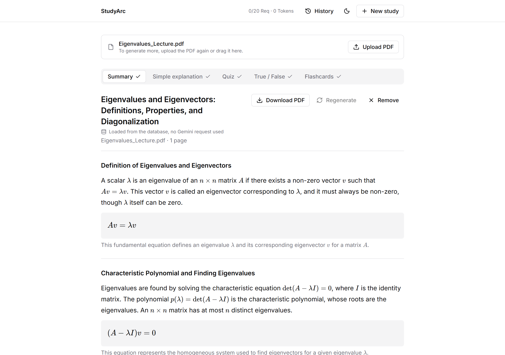
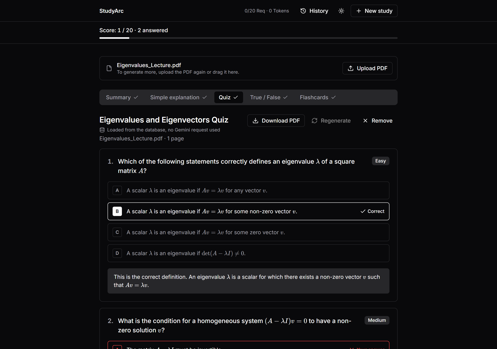
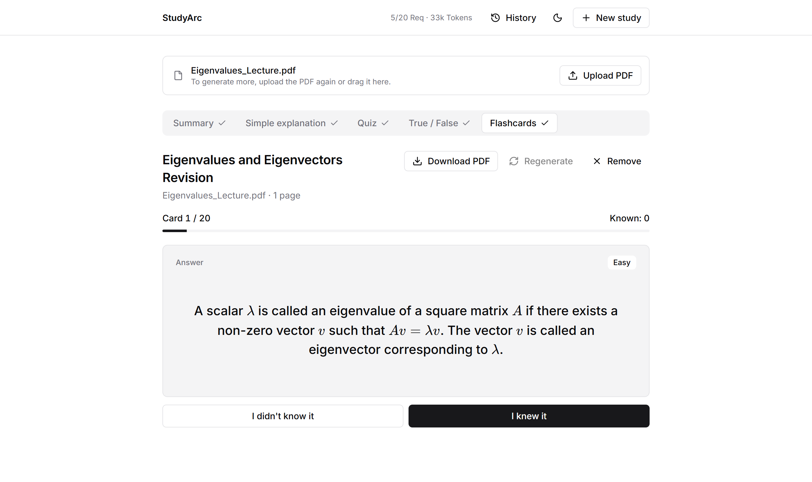

# StudyArc

I built this in my free time to make studying a bit easier for me and my friends.

Upload a lecture PDF and get a summary, a plain-language explanation, a quiz, true/false questions and flashcards. The output follows the language of the PDF, so Greek notes give you Greek material, and formulas are rendered with KaTeX.



| Quiz | Flashcards | Mobile |
|---|---|---|
|  |  |  |

Quizzes and true/false sets have 20 items each, with an explanation for every answer. Flashcards let you repeat only the ones you missed. Anything can be exported as an A4 PDF, and past studies stay in your browser's local storage, so there are no accounts.

## Stack

Next.js 15, React 19, TypeScript, Tailwind 4 and shadcn/ui. PDFs are parsed with `unpdf`, the material comes from Gemini (`gemini-2.5-flash`) in JSON mode, and generated results are cached in Supabase.

## Things that needed some thought

**A small quota.** The free Gemini tier gave me 20 requests a day for this model, and a full study uses 5. Results are cached in memory and in a Postgres table, keyed on a hash of the document text, format, model and prompt. Uploading the same text again costs nothing, and changing a prompt doesn't serve old results. Only the generated material is stored, never the PDF, its text or anyone's answers. If the database is down or slow (free Supabase projects pause when idle), requests just go to Gemini after a 2.5 second timeout.

**Unreliable model output.** Testing with real responses showed that Gemini sometimes wraps math in `\(...\)` instead of `$...$`, and sometimes escapes LaTeX twice. Both show up as raw text on the page, so `lib/ai/validate.ts` repairs them before anything reaches the UI.

**Rate limit errors.** Every 429 from Gemini mentions "plan and billing details", including the per-minute ones, so that phrase can't be used to detect the daily limit. Per-minute limits are retried with backoff and the daily limit is reported right away.

**Long documents.** Up to about 400k characters goes to the model in one call. Longer documents are split into chunks and the results merged.

The Gemini SDK is only imported in `lib/ai/gemini.ts`, so another provider would mean implementing one interface.

## Running it

You need Node.js and a [Gemini API key](https://aistudio.google.com/apikey).

```bash
npm install
cp .env.local.example .env.local   # add GEMINI_API_KEY
npm run dev
```

Check your own limit at [ai.dev/rate-limit](https://ai.dev/rate-limit). If it isn't 20, change `REQUEST_LIMIT` in `lib/study.ts` so the counter in the top bar matches.

The database is optional. Without it, the cache only lives in memory. To use it, run `supabase/schema.sql` in a Supabase project and add these to `.env.local`:

```bash
SUPABASE_URL=https://your-project.supabase.co
SUPABASE_SECRET_KEY=sb_secret_...
```

The secret key stays on the server. Row level security is on with no policies, so the public keys can't reach the table.

## Tests

These run offline and don't need a key:

```bash
node scripts/verify-extract.mjs   # PDF extraction and its error cases
node scripts/verify-parse.mjs     # validators and LaTeX repair
node scripts/verify-step4.mjs     # queue, caches, chunking, error classification
```

To try the prompts without the UI (this uses your quota):

```bash
npm run test:pipeline -- samples/your-lecture.pdf summary
```

`.txt` and `.md` files work too, and `samples/` is git-ignored.
