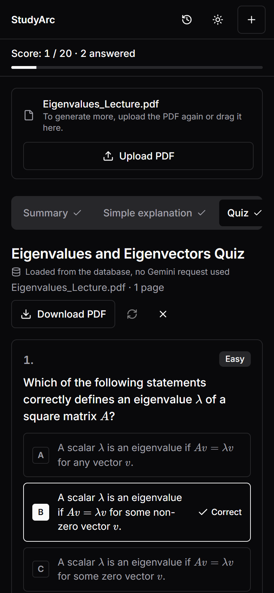

# StudyArc

Turn a lecture PDF into study material. Upload a PDF and StudyArc uses Google Gemini to generate a summary, a simple explanation, a quiz, a true/false set and flashcards, all in the language of the document and with math rendered properly.


## Features

- **Five study formats:** summary with key formulas and exam tips, simple explanation with analogies, 20-question quiz, 20 true/false statements, and 20 flashcards with repeat rounds for the cards you missed.
- **Follows the document's language:** a Greek lecture produces Greek material and an English lecture produces English material. The interface is in English.
- **Math that renders:** formulas are LaTeX, rendered with KaTeX in every view.
- **PDF export:** any format can be printed or saved as a clean A4 document, and quizzes always include the answer key.
- **History without an account:** past studies stay in your browser's `localStorage`.
- **Light and dark themes,** and a layout that works down to 360px.

| Quiz | Flashcards | Mobile |
|---|---|---|
|  |  |  |

## How it works

```
PDF → text (unpdf) → Gemini in JSON mode → validated, typed material → KaTeX-rendered UI
```

The interesting part is what sits around the model call, because model output and free-tier APIs are both unreliable:

- **Provider-agnostic core.** `GeminiProvider` is the only file that imports the SDK. Another backend can be added by implementing one interface, with no changes for callers.
- **Resilience.** Requests go through a serializing queue, with exponential backoff and jitter on transient 5xx and 429 errors. Per-minute limits are retried, while the daily limit is reported to the user straight away.
- **Two-level cache.** Results are cached in memory and in a Supabase Postgres table, so they survive restarts and serverless cold starts. The key is a SHA-256 of the document text, format, model and prompt: anyone uploading the same text gets the material instantly with no API request, and improving a prompt never serves stale results. The interface shows which level answered. PDFs, their text and users' answers are never stored. If the database is slow or down, requests simply continue to Gemini.
- **Long documents.** Lectures of up to about 120 pages go to the model in one call for the best quality. Anything longer is split into chunks and the results are merged.
- **Validation and repair.** Every response is checked and converted to typed data. The validator also repairs mistakes seen in real model output: over-escaped LaTeX and math delimiters that the UI can't render.
- **Coverage across formats.** The quiz, true/false and flashcard prompts are told what the other formats already cover, so they test different concepts where the document allows it.

## Tech stack

Next.js 15 (App Router), React 19, TypeScript, Tailwind CSS 4, shadcn/ui, KaTeX, `unpdf`, `@google/genai` and Supabase (Postgres).

## Run it locally

You need Node.js and a free [Gemini API key](https://aistudio.google.com/apikey).

```bash
npm install
cp .env.local.example .env.local     # then add your GEMINI_API_KEY
npm run dev                          # http://localhost:3000
```

The default model is `gemini-2.5-flash`. Set `GEMINI_MODEL` to use another one.

On the free tier the API reported a limit of 20 requests per day for this model in October 2026, and a full study uses 5 of them. You can check your own limit in [AI Studio](https://ai.dev/rate-limit). If it differs, update `REQUEST_LIMIT` in `lib/study.ts` so the counter in the top bar matches.

### Optional: the database cache

The app runs without a database, using the in-memory cache only. To add one, create a Supabase project, run `supabase/schema.sql` in its SQL Editor, and add these to `.env.local`:

```bash
SUPABASE_URL=https://your-project.supabase.co
SUPABASE_SECRET_KEY=sb_secret_...     # server only, never expose it to the browser
```

Row level security is on with no policies, so only the server's secret key can reach the table. Free Supabase projects pause after a period of inactivity; while paused, the app keeps working and just generates material as usual.

## Tests

These run offline, with no API key:

```bash
node scripts/verify-extract.mjs   # PDF text extraction and its error cases
node scripts/verify-parse.mjs     # validators and LaTeX repair
node scripts/verify-step4.mjs     # queue, both caches, chunking and error classification
```

To try the prompts on your own material without the UI (this uses your API quota):

```bash
npm run test:pipeline -- samples/your-lecture.pdf summary   # or eli5, quiz, truefalse, flashcards
```

`.txt` and `.md` files work too. The `samples/` folder is git-ignored.

## Project layout

```
app/page.tsx            page state and data flow
app/api/generate/       upload → extract → generate route
components/             the interface; components/ui/ holds the shadcn/ui parts
lib/pdf.ts              PDF → text, with typed errors (empty, corrupt, scanned)
lib/exportPdf.ts        print template for PDF export
lib/cache.ts            cache interfaces, in-memory cache and key
lib/supabaseCache.ts    durable cache; every failure counts as a miss
supabase/schema.sql     the database table
lib/ai/
  generate.ts           orchestration: cache → de-duplication → queue → chunking → provider
  gemini.ts             GeminiProvider, the only file importing the SDK
  prompts.ts            system prompts for each format
  validate.ts           JSON → typed material, including LaTeX repair
  retry.ts, queue.ts, chunking.ts    resilience layer
```
